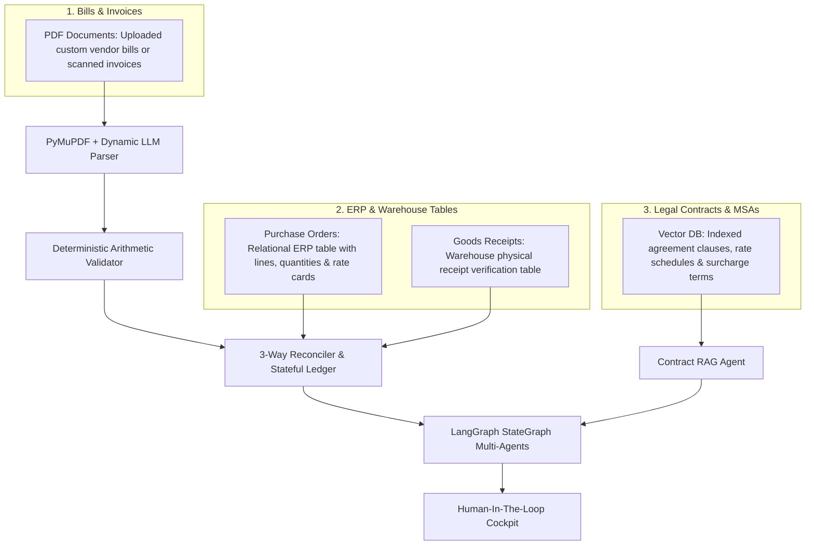

# Procurement Invoice & Contract Auditor

An enterprise procurement audit system combining **100% deterministic arithmetic & stateful ledger tracking** with **GenAI, OCR, FastAPI, LangChain, and LangGraph-powered Multi-Agent RAG**.

Inspired by [`invoice-agent`], this system protects procurement and accounts payable teams against:
- Invoice arithmetic discrepancies & rounding errors
- Purchase Order (PO) rate card variances and quantity overbilling
- Unreceived shipments (3-way matching against Goods Receipts)
- Hidden stealth charges (e.g., unauthorized fuel or freight surcharges prohibited by Master Service Agreements)
- Multi-invoice cumulative overbilling across split shipments
- Missing mandatory fields, with explicit routing to **Human-in-the-Loop (HITL)** review

---

## 🏛️ Core Architectural Principle

> **"Never let an LLM do arithmetic; never let a rule engine interpret legal nuances."**
>
> Mathematical reconciliation, tax calculations, and cumulative volume limits remain **100% deterministic and auditable** using fixed-precision decimal arithmetic (`decimal.Decimal`). GenAI and Multi-Agent RAG are utilized where they excel: dynamically extracting unstructured documents, interpreting complex contractual clauses, correlating anomalies, explaining discrepancies, and conducting conversational investigations.

---

## 🔍 Why Use a Stateful Ledger?

In real-world enterprise procurement, **auditing invoices in isolation (statelessly) is one of the most common causes of multi-million dollar overpayments**.

1. **Cumulative Overbilling Across Split Shipments:**
   A company issues a PO for 10 units. A vendor ships in two batches:
   - *Week 1:* Invoice A bills **7 units** $\rightarrow$ Valid ($7 \le 10$) $\rightarrow$ Paid.
   - *Week 3:* Invoice B bills **5 units** $\rightarrow$ If audited statelessly, an LLM sees $5 \le 10$ and approves it!
   - **With the Cumulative Ledger:** The ledger tracks prior billings: $7 + 5 = 12 > 10$. It automatically flags **`QTY_EXCEEDS_ORDERED`** (overbilled by 2 units).
2. **Duplicate Invoice Submission Prevention:**
   Vendors often re-submit invoices accidentally or fraudulently. The Ledger maintains unique submission fingerprints (`vendor`, `invoice_number`, `currency`, `total`) to catch exact duplicates (`DUPLICATE_INVOICE`) and near-duplicates (`POSSIBLE_DUPLICATE`).
3. **Open PO Balance Tracking:**
   Tracks remaining authorized quantities and open balances per line item across the PO lifecycle.

---

## 📋 Real-Life Tripartite Document Formats

The system reflects how enterprise procurement operations function in practice:



- **Bills & Invoices**: **PDF Documents** (uploaded custom vendor PDFs, scanned receipts, or digital invoices).
- **Purchase Orders (POs)**: **Relational ERP Table** (`PO Number`, `Vendor`, `Line #`, `SKU`, `Description`, `Qty`, `Unit Price`, `Line Amount`).
- **Goods Receipts (GRs)**: **Warehouse Verification Table** (`Receipt ID`, `PO Reference`, `Receipt Date`, `Line #`, `SKU`, `Qty Received`, `Status`).
- **Contracts / MSAs**: **Vector DB Store** with semantic retrieval and live clause addition.

---

## ⚡ Key Features

1. **Deterministic Arithmetic Precision**: All currency and quantities strictly use `decimal.Decimal` with fixed-precision rounding (`0.01`). Floats never touch an amount.
2. **Dynamic LLM Extraction with Fallback**:
   - Uses `gpt-4o-mini` or Google Gemini when API keys are configured (`OPENAI_API_KEY` or `GEMINI_API_KEY`).
   - Automatically falls back to a robust local semantic parser that converts text to lowercase (`.lower()`) and extracts fields dynamically without crashing when offline.
3. **Immediate Processing Upon Upload**: Drag-and-drop or upload any PDF invoice in the UI, and processing starts immediately—no manual secondary clicks needed.
4. **Explicit Human-in-the-Loop (HITL) Alerts**: When required fields (`invoice_number`, `vendor`, `po_number`, `line_items`) are incomplete or missing, the system explicitly raises:
   > *"Missing required field '{field}'. Please use Human-In-The-Loop review to manually verify or key in this field from the document."*
5. **Contract Clause Vector RAG**: Tokenizes and indexes legal clauses using lowercase matching. The LLM interprets contractual nuances (e.g., whether separate freight/fuel fees are forbidden) and attaches concrete citations.
6. **Streamlined LangGraph Multi-Agents**: Linear state graph bounded by strict max iterations (`recursion_limit = 5`) and automatic deduplication to eliminate data redundancy.
7. **Auditor AI Copilot Chatbot**: Real-time conversational assistant aware of active invoice findings, ERP tables, and retrieved contract clauses.
8. **Synthetic Benchmark Generator**: Inspired by `invoice-agent generate-dataset`, creates coordinated test sets with seeded discrepancies.

---

## 🚀 Quickstart Guide

### 1. Configure Environment (Optional)
To enable cloud LLM reasoning, create a `.env` file (or export environment variables):
```bash
OPENAI_API_KEY="your-openai-api-key"
# or
GEMINI_API_KEY="your-gemini-api-key"
```
*(If no API key is provided, the system seamlessly uses the local lowercase semantic engine without crashing).*

### 2. Run the Automated Test Suite
```bash
python -u -m pytest -p no:deepeval tests/test_core.py -v
```

### 3. Start the Server
```bash
python run_server.py
```
- **Auditor Cockpit & Chatbot:** [http://127.0.0.1:8000/](http://127.0.0.1:8000/)
- **Interactive OpenAPI Documentation:** [http://127.0.0.1:8000/docs](http://127.0.0.1:8000/docs)

---

## 🖥️ Cockpit Interface Views

The web cockpit provides three integrated views:

1. **Invoice Audit Cockpit**:
   - Immediate drag-and-drop PDF upload & live processing.
   - Side-by-side discrepancy cards with severity badges (`AUTO_APPROVE`, `NEEDS_REVIEW`, `REJECT`).
   - Attached evidence bundle citing specific PO lines and contract clauses.
   - Human-in-the-Loop decision bar (`Approve`, `Flag for Correction`, `Reject`) with audit log recording.
   - Embedded AI Copilot Chatbot.
2. **ERP Tables (PO & Receipts)**:
   - Interactive relational tables for authorized Purchase Orders and Warehouse Goods Receipts.
3. **Vector DB Contracts**:
   - Visual inspector of all indexed contract clauses, token counts, and surcharge restrictions.
   - Dynamic form to index new contract clauses on the fly, immediately displaying the embedded details.

---

## 🧪 Seeded Synthetic Benchmark Scenarios

| Scenario ID | Test Condition | Expected Action | Reason Code |
| :--- | :--- | :--- | :--- |
| `INV-101` | Clean 3-way match against PO and Goods Receipt | `AUTO_APPROVE` | Zero discrepancies |
| `INV-102` | Unit price inflated from $600 to $750 | `NEEDS_REVIEW` | `PRICE_VARIANCE` |
| `INV-103` | Omitted vendor and line items from document | `NEEDS_REVIEW` | `MISSING_REQUIRED_FIELD` (Explicit HITL) |
| `INV-105` | $150 freight surcharge added, violating MSA clause | `REJECT` | `UNAUTHORIZED_SURCHARGE` |

---

## 📂 Project Structure

```
Intelligent_Invoice_System/
  ├── src/
  │   ├── core/
  │   │   ├── schema.py          # Strict Decimal types, Enums, Reason, HITL models
  │   │   ├── arithmetic.py      # Deterministic line item, subtotal, and total validation
  │   │   ├── matcher.py         # 2-way / 3-way matching + cumulative PO ledger
  │   │   └── llm.py             # Dynamic LLM client (OpenAI/Gemini/Fallback)
  │   ├── extractor/
  │   │   └── pdf_extractor.py   # Dynamic PDF extractor with Y-coordinate reconstruction
  │   ├── rag/
  │   │   └── contract_rag.py    # Vector RAG with lowercase tokenization & clause auditing
  │   ├── agents/
  │   │   └── graph.py           # Streamlined LangGraph StateGraph workflow
  │   ├── hitl/
  │   │   └── review_manager.py  # Human review recorder & audit trail logging
  │   ├── synth/
  │   │   └── dataset_gen.py     # Synthetic procurement dataset generator (PyMuPDF)
  │   └── api/
  │       └── main.py            # FastAPI service, ERP tables & chatbot endpoints
  ├── static/
  │   ├── index.html             # Multi-tab Auditor Cockpit UI
  │   └── app.js                 # Client-side controller & immediate upload processing
  ├── tests/
  │   └── test_core.py           # Automated unit and integration tests (100% passing)
  ├── run_server.py              # Application launcher
  └── README.md
```
